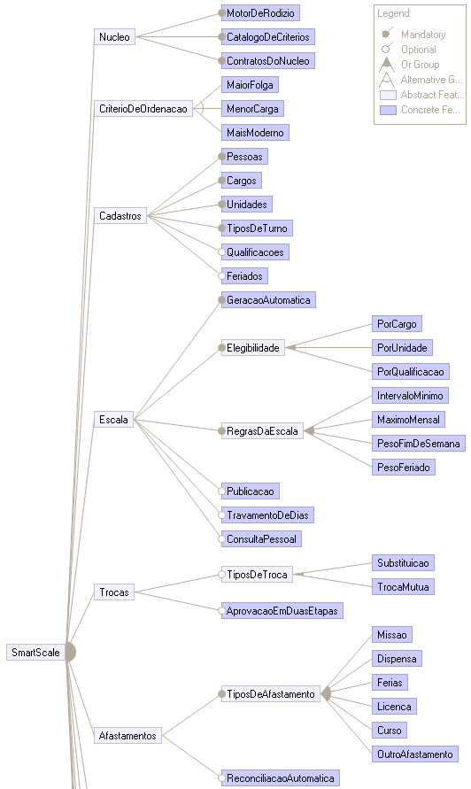
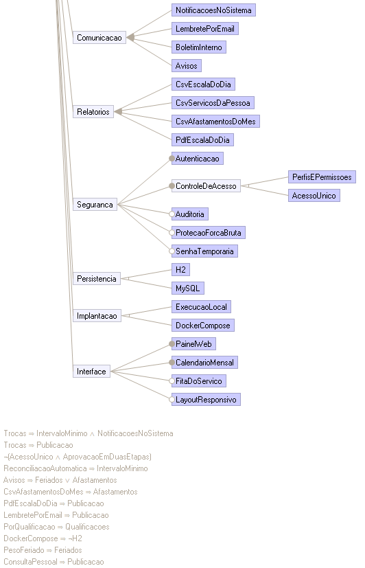

# Modelo de características da linha de produto SmartScale

Desenvolvimento Orientado a Reuso de Software · PUCPR · Engenharia de Software, 6º período · prof. Tiago Navarro

## 1. O domínio e seus limites

A SmartScale é uma linha de produto de **escalas de serviço por rodízio**: distribuir pessoas em turnos de forma justa, respeitando quem pode tirar cada turno, o descanso entre turnos e as ausências. O primeiro produto da linha é o **MilScale**, a escala de serviço de 24 horas de um batalhão. Um segundo produto, **Plantão Hospitalar**, é usado neste documento para mostrar como a mesma linha gera um sistema diferente.

**Dentro do domínio:** cadastro de quem é escalado e da estrutura da organização, geração e publicação da escala, regras de rodízio, trocas de turno, afastamentos, comunicação da escala, relatórios, segurança de acesso, persistência e implantação.

**Fora do domínio, com a relação de cada um:**

| Domínio vizinho | Relação com a SmartScale |
|---|---|
| Recursos humanos e folha de pagamento | Fornece as pessoas. Hoje o cadastro é manual; a integração seria uma feature nova (importação) |
| Controle de ponto e frequência | Consome a escala. Os relatórios CSV são o ponto de troca de dados |
| Autenticação corporativa (SSO, LDAP) | Poderia substituir a feature `Autenticacao`. Fica fora do modelo atual |
| Controle de material e logística | Sem relação. O MilScale roda num batalhão de suprimento, mas não gerencia material |

## 2. O diagrama

O modelo foi feito no **FeatureIDE 3.12** (Eclipse) e está versionado em `docs/modelo-de-caracteristicas/SmartScale/model.xml`. A imagem exportada do FeatureIDE (`SmartScale-modelo.png`) é alta demais para uma página, então aparece aqui em duas partes. A legenda está no canto superior direito da parte 1, e as 12 restrições, no fim da parte 2.

**Parte 1 de 2:** Nucleo, CriterioDeOrdenacao, Cadastros, Escala, Trocas e Afastamentos

**Parte 2 de 2:** Comunicacao, Relatorios, Seguranca, Persistencia, Implantacao, Interface e as restrições

| Número | Quantidade |
|---|---|
| Características (features) | 73 |
| Abstratas | 18 |
| Concretas | 55 |
| Obrigatórias (Mandatory) | 24 |
| Opcionais (Optional) | 16 |
| Grupos Or | 6 grupos, 23 features |
| Grupos Alternative | 4 grupos, 9 features |
| Restrições (constraints) | 12 |

O modelo tem configurações válidas, nenhuma feature morta, nenhuma feature falsamente opcional e nenhuma restrição redundante. Isso foi verificado pela análise do próprio FeatureIDE e pelo script `docs/modelo-de-caracteristicas/validar_modelo.py` (seção 6).

## 3. Abstract e Concrete

**Feature abstrata** é um agrupamento que existe para organizar o modelo e não corresponde, sozinha, a código. **Feature concreta** corresponde a código, configuração ou arquivo do sistema.

| Tipo | Features | Justificativa |
|---|---|---|
| Abstract | `SmartScale`, `Nucleo`, `CriterioDeOrdenacao`, `Cadastros`, `Escala`, `Elegibilidade`, `RegrasDaEscala`, `Trocas`, `TiposDeTroca`, `Afastamentos`, `TiposDeAfastamento`, `Comunicacao`, `Relatorios`, `Seguranca`, `ControleDeAcesso`, `Persistencia`, `Implantacao`, `Interface` | São categorias. "Comunicacao", por exemplo, não tem uma classe: quem tem código são as filhas (`NotificacaoService`, `LembreteServicoService`). Marcar como abstrata evita que a configuração de um produto "selecione" algo que não gera nada |
| Concrete | as outras 55 | Cada uma aponta para um artefato real. Exemplos na tabela abaixo |

| Feature concreta | Onde está |
|---|---|
| `MotorDeRodizio` | `smartscale-core/.../MotorDeRodizio.java` (núcleo reutilizável) |
| `CatalogoDeCriterios` | `smartscale-core/.../CatalogoDeCriterios.java` (Singleton) |
| `ContratosDoNucleo` | `PessoaEscalada`, `TipoTurno` e `CriterioDeOrdenacao` no núcleo |
| `MaiorFolga`, `MenorCarga`, `MaisModerno` | `CriterioOrdenacaoMilitar`, `CriterioMenorCargaNaGeracao`, `CriterioMaisModernoPrimeiro` (Strategy) |
| `Pessoas`, `Cargos`, `Unidades`, `TiposDeTurno` | `Militar`, `PostoGraduacao`, `Subunidade`, `TipoServico` e suas telas |
| `GeracaoAutomatica` | `GerarEscalaService` |
| `IntervaloMinimo`, `MaximoMensal` | `PoliticaDeDescanso` e `RegraEscala.maxServicosMes` |
| `PesoFimDeSemana`, `PesoFeriado` | parâmetros de `RegraEscala`, cadastrados na tela Regras da escala |
| `Publicacao`, `TravamentoDeDias`, `ConsultaPessoal` | `PublicarEscalaService`, `BloqueioDiaService`, `MinhaEscalaService` |
| `Substituicao`, `TrocaMutua`, `AprovacaoEmDuasEtapas` | `SolicitacaoService` (`criar`, `criarTrocaMutua`, `triagem`, `autorizar`) |
| `ReconciliacaoAutomatica` | `AfastamentoService.reconciliarServicosJaMarcados` |
| `NotificacoesNoSistema`, `LembretePorEmail`, `BoletimInterno`, `Avisos` | `NotificacaoService`, `LembreteServicoService`, `BoletimService`, `AvisoService` |
| `CsvEscalaDoDia`, `CsvServicosDaPessoa`, `CsvAfastamentosDoMes` | `RelatorioEscalaDoDia`, `RelatorioServicosDoMilitar`, `RelatorioAfastamentosDoMes` (Template Method) |
| `PdfEscalaDoDia` | tela `EscalaPdf.tsx` |
| `Autenticacao`, `PerfisEPermissoes` | `MilScaleUserDetailsService`, `PerfilAcesso` e `@PreAuthorize` |
| `Auditoria`, `ProtecaoForcaBruta`, `SenhaTemporaria` | `AuditoriaService`, `ProtecaoContraForcaBruta`, `SenhaTemporariaFilter` |
| `H2`, `MySQL` | `application.properties` e `application-mysql.properties` |
| `ExecucaoLocal`, `DockerCompose` | `mvn spring-boot:run` e `docker-compose.yml` |
| `PainelWeb`, `CalendarioMensal`, `FitaDoServico`, `LayoutResponsivo` | `Painel.tsx`, `CalendarioMensal.tsx`, `FitaDoServico.tsx`, regras `@media` de `styles.css` |

`AcessoUnico` é a única feature concreta sem implementação no MilScale: é a variante prevista para organizações pequenas, com um só perfil que faz tudo. Ela existe no modelo para o produto Plantão Hospitalar.

## 4. Mandatory e Optional

**Mandatory (obrigatória):** todo produto da linha tem. **Optional (opcional):** o produto pode ter ou não.

| Tipo | Feature | Justificativa |
|---|---|---|
| Mandatory | `Nucleo` e as três filhas | É o ativo reutilizável (`smartscale-core` 1.0.0). Sem ele não há linha de produto |
| Mandatory | `CriterioDeOrdenacao` | Toda escala por rodízio precisa decidir quem vai primeiro na fila |
| Mandatory | `Cadastros` com `Pessoas`, `Cargos`, `Unidades`, `TiposDeTurno` | Sem quem escalar, onde e em qual turno, o motor não tem entrada |
| Mandatory | `Escala` com `GeracaoAutomatica`, `Elegibilidade`, `RegrasDaEscala` | É o propósito do sistema: gerar a escala respeitando quem pode e quando pode |
| Mandatory | `TiposDeTroca`, `TiposDeAfastamento` | Obrigatórias **dentro** de `Trocas` e `Afastamentos`: se o produto tem o módulo, precisa ter ao menos um tipo |
| Mandatory | `Seguranca` com `Autenticacao` e `ControleDeAcesso` | A escala expõe dados pessoais; ninguém acessa sem login |
| Mandatory | `Persistencia`, `Implantacao` | Todo produto guarda dados e precisa rodar em algum lugar; o que varia é **qual** |
| Mandatory | `Interface` com `PainelWeb` e `CalendarioMensal` | A escala é consultada por calendário em qualquer produto |
| Optional | `Qualificacoes`, `Feriados` | Uma organização pode não exigir cursos nem tratar feriados de forma diferente |
| Optional | `Publicacao` | Um produto simples pode mostrar a escala assim que é gerada, sem rascunho |
| Optional | `TravamentoDeDias`, `ConsultaPessoal` | Recursos de controle e de autoatendimento que nem toda organização usa |
| Optional | `Trocas` e `AprovacaoEmDuasEtapas` | Há organizações que não permitem troca; e as que permitem podem dispensar a triagem |
| Optional | `Afastamentos` e `ReconciliacaoAutomatica` | Um produto pode tratar ausências fora do sistema; a realocação automática é um diferencial |
| Optional | `Comunicacao`, `Relatorios` | Valor agregado, não essencial para gerar a escala |
| Optional | `Auditoria`, `ProtecaoForcaBruta`, `SenhaTemporaria` | Endurecimento de segurança que depende do nível de exigência do cliente |
| Optional | `FitaDoServico`, `LayoutResponsivo` | Recursos de interface do MilScale que outro produto pode não querer |

## 5. Or Group e Alternative Group

**Or Group:** escolher **um ou mais** filhos. **Alternative Group:** escolher **exatamente um**.

| Tipo | Grupo | Filhos | Justificativa |
|---|---|---|---|
| Or | `Elegibilidade` | `PorCargo`, `PorUnidade`, `PorQualificacao` | Os filtros se somam: o MilScale usa os três ao mesmo tempo (`ElegibilidadeService`), um hospital pode usar só cargo e especialidade |
| Or | `RegrasDaEscala` | `IntervaloMinimo`, `MaximoMensal`, `PesoFimDeSemana`, `PesoFeriado` | As regras são independentes e combináveis; pelo menos uma é preciso para o rodízio ter critério de descanso ou carga |
| Or | `TiposDeTroca` | `Substituicao`, `TrocaMutua` | Um produto pode aceitar só substituição, só troca mútua ou as duas |
| Or | `TiposDeAfastamento` | `Missao`, `Dispensa`, `Ferias`, `Licenca`, `Curso`, `OutroAfastamento` | Cada organização tem seus motivos de ausência; o MilScale usa os seis (`TipoAfastamento`) |
| Or | `Comunicacao` | `NotificacoesNoSistema`, `LembretePorEmail`, `BoletimInterno`, `Avisos` | Canais que convivem; o e-mail, por exemplo, é ligado por configuração |
| Or | `Relatorios` | `CsvEscalaDoDia`, `CsvServicosDaPessoa`, `CsvAfastamentosDoMes`, `PdfEscalaDoDia` | Cada relatório atende um público e pode ser incluído sozinho |
| Alternative | `CriterioDeOrdenacao` | `MaiorFolga`, `MenorCarga`, `MaisModerno` | A fila só pode ter uma ordem. É o ponto de variação RN01, escolhido na inicialização por `MILSCALE_CRITERIO_ORDENACAO` |
| Alternative | `ControleDeAcesso` | `PerfisEPermissoes`, `AcessoUnico` | Ou o sistema separa papéis, ou todo usuário pode tudo; as duas coisas ao mesmo tempo são contraditórias |
| Alternative | `Persistencia` | `H2`, `MySQL` | Uma instalação usa um banco. Escolhido pelo perfil do Spring (`mysql` ou padrão) |
| Alternative | `Implantacao` | `ExecucaoLocal`, `DockerCompose` | A instalação roda de um jeito: pelo Maven na máquina ou pelos containers |

## 6. Restrições (constraints)

As 12 restrições usam os quatro operadores pedidos: **Implies** (⇒), **And** (∧), **Or** (∨) e **Not** (¬). Todas vêm de dependências reais do código, indicadas na última coluna.

| Código | Restrição | Operadores | Justificativa | Onde no código |
|---|---|---|---|---|
| R01 | `Trocas ⇒ (IntervaloMinimo ∧ NotificacoesNoSistema)` | Implies, And | A troca precisa conferir o descanso de quem assume e avisar o substituto | `SolicitacaoService` usa `PoliticaDeDescanso` e `NotificacaoService` |
| R02 | `Trocas ⇒ Publicacao` | Implies | Só se troca serviço de escala publicada; rascunho ainda pode mudar | `SolicitacaoService` exige `SituacaoEscala.PUBLICADA` |
| R03 | `¬(AcessoUnico ∧ AprovacaoEmDuasEtapas)` | Not, And | A aprovação em duas etapas precisa de dois papéis (Cabo faz a triagem, Sargenteante autoriza); com um perfil só não há quem divida o fluxo | `SolicitacaoController`: triagem para Cabo e Sargenteante, autorização só para Sargenteante (`@PreAuthorize`) |
| R04 | `ReconciliacaoAutomatica ⇒ IntervaloMinimo` | Implies | Ao realocar o serviço de quem se afastou, o substituto precisa respeitar o descanso | `AfastamentoService` usa `PoliticaDeDescanso` |
| R05 | `Avisos ⇒ (Feriados ∨ Afastamentos)` | Implies, Or | O mural de avisos é montado a partir de feriados ou de afastamentos; sem nenhum dos dois ficaria vazio | `AvisoService` lê `FeriadoRepository` e `AfastamentoRepository` |
| R06 | `CsvAfastamentosDoMes ⇒ Afastamentos` | Implies | O relatório lista afastamentos; sem o módulo não há dados | `RelatorioAfastamentosDoMes` |
| R07 | `PdfEscalaDoDia ⇒ Publicacao` | Implies | O PDF é o documento oficial do dia; só mostra escala publicada | `EscalaPdf.tsx` ("Nenhuma escala publicada cobre esse dia") |
| R08 | `LembretePorEmail ⇒ Publicacao` | Implies | O lembrete não pode avisar um serviço que ainda é rascunho | `LembreteServicoService` filtra `PUBLICADA` |
| R09 | `PorQualificacao ⇒ Qualificacoes` | Implies | Filtrar por curso exige o cadastro de cursos | `ElegibilidadeService` lê `Militar.getQualificacoes()` |
| R10 | `DockerCompose ⇒ ¬H2` | Implies, Not | O Compose sobe o MySQL e o backend no perfil `mysql`; o banco embarcado não é usado em container | `docker-compose.yml` e `backend/Dockerfile` |
| R11 | `PesoFeriado ⇒ Feriados` | Implies | O peso extra vale para os dias que o cadastro de feriados marca | `RegraEscala.pesoFeriado` e `Feriado` |
| R12 | `ConsultaPessoal ⇒ Publicacao` | Implies | O militar só vê a própria escala depois de publicada | `MinhaEscalaService` filtra `PUBLICADA` |

## 7. Configurações de produto

A engenharia de aplicação escolhe as features de cada produto. As configurações estão em `docs/modelo-de-caracteristicas/SmartScale/configs/` e o FeatureIDE as valida contra o modelo.

| Configuração | Escolhas que a diferenciam | Features selecionadas |
|---|---|---|
| `MilScale-Docker` | `MaiorFolga`, `PerfisEPermissoes`, `MySQL`, `DockerCompose`, todos os opcionais | 68 de 73 |
| `MilScale-Desenvolvimento` | igual à anterior, com `H2` e `ExecucaoLocal` | 68 de 73 |
| `PlantaoHospitalar` | `MenorCarga`, `AcessoUnico`, só `Substituicao`, sem `Avisos` nem `BoletimInterno`, sem `TravamentoDeDias` | 52 de 73 |

**Momento da escolha (binding time):**
- **Na inicialização:** o critério da fila, pela propriedade `milscale.lps.criterio-ordenacao`, e a persistência, pelo perfil do Spring.
- **Na implantação:** a forma de rodar, pelo uso ou não do `docker-compose.yml`.
- **Na construção do produto:** as demais features, pela presença do módulo no código.

## 8. Como o modelo foi validado

- **No FeatureIDE:** o editor do modelo não mostra avisos de feature morta, falsamente opcional ou restrição redundante, e as três configurações abrem como válidas.
- **Por script:**
  - `validar_modelo.py` traduz o modelo para lógica proposicional e usa um resolvedor SAT (`python-sat`) para conferir as mesmas propriedades;
  - também confere as exigências desta entrega: pelo menos 10 restrições, uso de Implies, And, Or e Not, e presença dos seis tipos de feature;
  - os 13 testes de `test_validar_modelo.py` provam que o script detecta cada problema.
